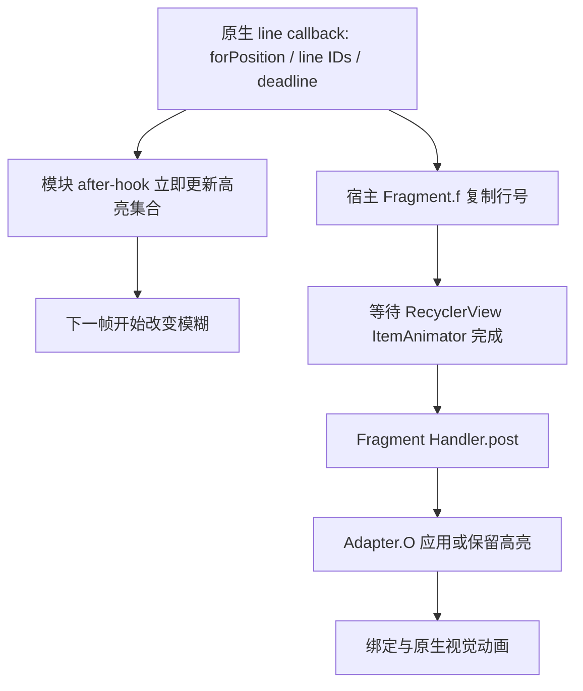

# 歌词模糊分析与重构方案

分析日期：2026-10-13。分支：`codex/lyrics-blur-analysis`。

本文分析仓库现有实现，并对用户提供的 `com.apple.android.music_7.0.0-beta-1609.apkm` 做了定向反编译；追加对照了本地已有的 6.5.3/1599 与 7.0.0-beta/1606 安装包。功能实现尚未修改；没有运行功能测试、设备操作、构建或哈希验证。

## 1. 结论与证据边界

建议重构。最值得先处理的是**高亮的来源、应用时点、行身份和状态生命周期**。现有代码已经分出策略和渲染器，效果缓存与帧合并也有价值；问题集中在宿主接入与运行时，继续往高亮集合里补条件很容易互相冲突。

“宿主高亮的歌词偶尔被模糊，逐行比逐字明显”有四条具体解释路径：

| 优先级 | 问题 | 源码依据 | 可能表现 |
| --- | --- | --- | --- |
| P1 | 歌词 ID 被当成列表位置 | 1609 的两种 adapter 都会动态插入三点行，并专门映射位置 | 间奏前后清晰行偏移，真正高亮行被模糊 |
| P1 | 模块提前删除宿主仍保留的高亮 | 逐行 adapter 保留非空子集过渡；模块只保留部分离开的行 | 重叠高亮中某一行持续被模糊 |
| P1 | 原生事件到达早于界面应用高亮 | 宿主等待 ItemAnimator 完成，再 post 应用；模块直接采用原生新集合 | 屏幕还高亮旧行，旧行已经开始模糊 |
| P1 | 三点焦点替换真实高亮 | opening/gap 策略用三点位置替换整组 active | 首句已经亮了，但整句仍有模糊 |

上表的调用关系和集合计算能由源码确定；**这些路径是否对应某一次实机现象、实际持续多久，仍需使用者手动确认**。本文中的集合示例是按源码推演，没有运行测试。

1609 的结论不能直接当作其他构建的运行结果。1599、1606 的独立源码证据和 1583、1586 的证据缺口见第10节。此次分析了 base APK 中 Java/DEX 层的关键路径，没有反编译原生歌词算法的 C++ 实现，也没有分析全部 ABI split。`forPosition`、`deadline` 的命名及 Java 层用途可确认，但没有据此假定原生内部全部时序规则。

## 2. 当前链路

| 层 | 主要实现 | 当前职责 |
| --- | --- | --- |
| 配置和能力 | `app/.../FutureLyricBlurFeature.kt:10` | 开关、Android 12 门禁、能力健康状态 |
| 宿主适配 | `host-applemusic/.../AppleMusicBidirectionalLyricBlurTarget.kt:23` | 符号解析、原生/VM/Fragment hooks、反射解码 |
| 来源选择 | 同文件 `LyricHighlightEventRouter:393` | native hook 安装后拒绝 VM fallback |
| 运行时 | `host-applemusic/.../OpenSourceLyricBlurPort.kt:24` | 歌曲、高亮、逐字、滚动、列表发现、帧调度、行分类 |
| 行高亮补偿 | `LyricHighlightSession.kt:28` | 空集合保留、首个高亮、部分重叠延续 |
| 词高亮补偿 | `LyricWordHighlightState.kt:19` | 四路词集合并集、子集过渡保护 |
| 模糊策略 | `core/.../BidirectionalBlurPolicy.kt:14` | 三点锚点、前后距离、半径偏移、量化、插值 |
| 平板视觉 | `core/.../TabletLyricVisualPolicy.kt:14` | 边缘模糊与高亮清晰合成 |
| 效果执行 | `LyricBlurRenderer.kt:33` | View 动画状态、RenderEffect 缓存、Choreographer |

1609 的关键差异是原生回调与实际显示之间还有一条处理链：



当前模块按上面左边的集合判断“清晰行”，用户看到的是右边的界面。两者不应被当成同一份状态。

## 3. 与高亮行误模糊直接相关的问题

### B1：nativeLineId 与 adapterPosition 不属于同一坐标空间

模块在 `OpenSourceLyricBlurPort.kt:274` 取每个 child 的 adapterPosition，随后在 `:325` 和 `:343` 直接用它查询 native 高亮集合。接口没有提供“这行 View 对应哪条歌词”的语义。

1609 宿主有明确的反例：

- 逐行 adapter `com.apple.android.music.player.R0.E(int, boolean)`：三点插入点 `x != -1` 时，插入点后的位置在读取歌词时减 1。
- 逐字 adapter `com.apple.android.music.player.A.E(int, boolean)`：同样处理插入点 `F`。
- 两者的 itemCount 在间奏期间额外加 1。逐行 adapter 的 item ID 读取先做映射，再取 `getLineId()`。

例如在第 5 个位置插入三点后，原本歌词 ID=5 的歌词会出现在列表位置 6。模块收到 `{5}` 却寻找位置 5，真正的歌词行 6 会被算成未来一行，基础半径是 8px。是否能看见这一窗口取决于三点插入/移除、宿主动画及模块帧的相对时序。

**修复方向：**适配层返回 `LyricRowSnapshot`，其中区分 `nativeLineId`、`lyricOrdinal`、`adapterPosition`、`kind` 和绑定代际。识别高亮用 native ID，计算歌词距离用歌词序号，识别三点/credits 用 row kind。有间奏行时不能靠统一减一修补全部情况。

### B2：逐行宿主的子集保留规则与模块不同

1609 `R0.O(List, int, Pair...)` 只有“输入为空，或输入不是旧集合的子集”才继续更新。其集合判定 `f1.D` 是包含关系。当前集合为 `{5,6}`、新输入为 `{5}` 时，宿主直接返回，仍保留 `{5,6}`。

模块 `LyricHighlightSession.kt:41` 只保留 `departedLineId < incoming.min()` 的离开行：

```text
原生输入                {5,6} -> {5}
1609 逐行 adapter 状态   {5,6} -> {5,6}
模块 session 状态        {5,6} -> {5}
```

在没有三点偏移的情况下，模块给第 6 行的目标半径已经是 8px，而宿主没有撤销它的高亮。这是逐行歌词更容易暴露问题的一条具体依据。逐字状态中有独立的词流与过渡保护，有时能保住第 6 行；不能把这种额外保护当作行状态正确的证明。

现有 `LyricHighlightSessionTest` 将 `{5,6}->{5}` 命名为 backward seek，并固定删除第 6 行。但**集合缩小本身不能证明用户倒退了进度**。1609 的逐字 adapter 也有自己的输入过滤，不能用同一个猜测规则复刻全部显示行为。

**修复方向：**读取实际提交后的 adapter 高亮快照，结合行绑定与宿主动画释放证据确定清晰保护。seek 使用真实位置/宿主事件确认；不要再从集合形状推断。

### B3：模块可能在宿主显示切换之前模糊旧高亮

1609 的 `PlayerLyricsViewFragment.f.invoke` 复制 native IDs 后调用 `r0.h(new L(...))`。`RecyclerView.k.h` 在动画进行时排队监听器；动画未进行时立即调用监听器。无论哪种情况，`L.a()` 都先调用 Fragment 的 Handler.post，Runnable 才执行 adapter 的 `O(...)`。

模块却在 `AppleMusicBidirectionalLyricBlurTarget.kt:149` 的 native wrapper after-hook 中直接替换 session。由 `{20}` 切到 `{21}` 时，宿主尚未应用新高亮，模块就可能把第 20 行目标改为 13px。

普通行通常靠行级状态维持高亮，逐字还可能有旧行的词事件，因此出现频率不同是合理推断。实际错位窗口与宿主动画和主线程负载有关，尚无实机测量。

**修复方向：**将 native 回调作为事件/预测信息，显示高亮由 adapter 应用与绑定边界决定。`O` 的 after-hook 可以读取已提交集合，但原生退出动画可能继续显示旧行；应使用绑定或动画完成证据撤销清晰保护，不能简单把“after O”视为所有像素已经完成过渡。

### B4：三点锚点能覆盖已经明确的真实高亮

`LyricHighlightSession.update` 在首个非空集合后令 opening=true。重复同一集合、空集合、再重复原集合，都不会结束 opening。

`BidirectionalBlurPolicy.selectInstrumentalGapAnchor` 在 opening=true、当前高亮包括最早可见歌词、前方有三点行时，即使 isGap=false 也返回三点位置。`resolveDisplayHighlights` 又让该位置直接取代整组 active。

源码推演：

```text
native active={1}, opening=true, visible lyrics=[1,2,3], instrumental=[0]
gap anchor=0 -> effective highlights={0}
歌词1的目标半径=8px
```

首句可能持续收到同一集合，因此这个状态能维持至下一组不同高亮。词集合并不保证解决这个 opening 分支；它主要帮助其他过渡路径。

空 native 集合也不应一概当作“显示已进入间奏”：1609 Fragment 对空集合还有 `deadline >= 7000` 的应用门槛，模块没有对应语义。只凭“附近有三点”选择最近锚点，也无法确认三点属于当前正在显示的间奏。

**修复方向：**拆开 `clearLineIds` 与 `focusAnchor`。三点可以影响周围歌词的距离场，但不能删除仍然可见高亮的清晰保护。间奏以宿主实际行种类、应用状态与时间信息确认，数据未知时优先保持可读。

## 4. 其他模糊 bug 与风险

### B5：手动滚动暂停会被普通高亮帧覆盖

`OpenSourceLyricBlurPort.kt:198` 设置 isUserScrolling；滚动事件在 `:235` 执行 `applyBlur(includeFocus=false, immediate=true)`。然而 native/word 事件安排的普通帧调用默认的 `applyBlur()`，includeFocus 又变为 true，函数不读取 isUserScrolling。

触发路径是：手动滚动先清除焦点模糊 → 播放过程中到达行/词事件 → 普通帧重新应用焦点模糊 → 下一次滚动事件再清除。可能看到拖动时模糊闪回或一顿一顿。恢复计时还会在每次滚动时安排，不能完整区分手指仍按住、惯性滚动和真正结束。

**方向：**一个 `InteractionMode` 控制所有更新入口；Dragging/Settling 时所有帧都遵守同一规则。到真正 idle 后再启动约 1 秒恢复。焦点模糊与可选边缘模糊分别表达，避免入口参数互相覆盖。

### B6：列表发现成功后没有首帧，绑定变化也没有明确刷新入口

`onLyricsViewCreated(:105)` 延迟 500ms 找列表；`findRecyclerView(:156)` 找到后只安装监听，没有安排一次模糊更新，也没有 child attach/行绑定观察。

若高亮已经在列表发现前发完，随后播放暂停、界面无滚动，新界面可能长期保持默认无模糊，直到再次收到事件。列表尺寸改变、翻译行重新绑定也没有独立的确定刷新路径。

**方向：**拿到真实 recycler 后立即按当前显示快照安排首帧。child attach、adapter/binding 改变、布局和可见性变化分别标记 dirty，再合并到一帧。

### B7：View 复用没有行身份，旧动画可能转移给新歌词

`LyricBlurRenderer.kt:24` 只用 View 作为 Transition 的 key；`animateTo(:39)` 从这个 View 的旧半径继续过渡。runtime 不记录绑定的歌词 ID，也没有在 detach/rebind 时终止该行的动画。

同一个 View 在相邻帧之间被重新绑定，可能从上一条歌词的模糊强度开始显示新歌词。目标恰好未变化时，renderer 会直接复用旧状态。WeakHashMap 解决的是对象引用生命周期，不能解决同一对象的内容身份变化。

**方向：**状态绑定到 View + documentGeneration + rowBindingGeneration；重绑定先结束旧动画、立即落到新行正确状态，再决定是否需要视觉过渡。detach 时释放本行状态，rebind 不靠等待下一条高亮事件。

### B8：NO_POSITION 会被当成有效歌词计算模糊

targetAccess 读取失败或 RecyclerView 处于临时布局状态时返回 -1。runtime 把它加入 visibleRows；只有部分锚点函数过滤负数，`targetRadius(-1, active)` 仍会给出非零半径，往往达到 22px。

因此动画/插入/布局期间暂时无法读取位置的真实高亮行可能被强模糊。此次反编译确认 1609 的 static int(View) accessor 本身能返回 -1，这不是纯跨版本猜测。

**方向：**优先读取稳定行身份；仍未知时不能参与距离计算或成为锚点，临时清晰并等待 binding/layout 补齐。需要区分“不是歌词”和“歌词身份暂时未知”。

### B9：native hook 安装后 fallback 永久失效，解码失败又伪装为空集合

Router `:399` 在 hook 安装时令 callbackInstalled=true；之后 VM4/VM1 都被拒绝。没有“当前文档实际收到有效数据”的判断，也没有运行中恢复路径。

`readLineIds(:269)` 吞掉单个元素的反射异常，可把非空原生 vector 解成空集或部分集合；word decoder 也会丢掉失败元素。这些结果随后进入正常高亮状态机，无法区分真间奏与数据损坏。

**方向：**解码返回 Valid/Partial/Unavailable，真实空集合是 Valid(empty)。partial/失败不能清空已知显示高亮。按文档和能力选择来源，暂停或本来无词时不以固定超时武断判定失败；必要时使用已确认的显示快照 fallback 或保持清晰。两个 VM 方法的语义不同，不能简单全部并集。

### B10：hook 部分失败，健康状态仍可能报告 Active

安装函数内多个 helper 捕获异常后只记日志；`install(:90)` 根据符号 resolution 判断 Active/Degraded，而不是 hook 实际注册情况。adapterPositionAccessor 为 null 时也可能打印 Reflection OK。

例如找到 Fragment 符号，但 destroy hook 注册失败，前面的 hooks 仍生效；界面状态与清理失配，外层看起来仍是安装成功。`hookAllMethods` 返回空集合也不会自行报错。

**方向：**使用项目已有 `HookRegistrationScope`，必需角色全部注册成功后 activate；失败 close 并停止模块写入。可选词流单独降级。能力报告包含实际安装角色与运行时读取失败，而不以日志代替状态。

### B11：缓存 recycler 与单一 Fragment owner 的生命周期不够完整

`getRv(:253)` 把“childCount>0”当作旧 recycler 有效，未检查它是否仍属于当前 root；发现 fresh recycler 时只换字段，没有把 touch/scroll observer 换到新列表。列表重建后可能向旧列表写效果、监听新列表失败。

runtime 还只保存一个 owner/root/recycler。新 Fragment 创建会释放旧 owner，而 native/word 回调没有 owner 或文档代际参数。项目有独立右栏歌词 Fragment；若多个歌词实例在生命周期过渡中并存，来源不能靠“最后创建的那个”自然对应。

清理视图只清 wordState，没有清 highlightSession；文档变化只在 processEvents 开始时识别。1609 的播放暂停路径可能不执行该函数，因此在暂停时切换/替换歌词、换到非同步或无歌词文档，存在使用旧高亮的风险。

这些结构缺口可由源码确认，具体的多实例串扰或暂停换歌症状仍待手动复现。1609 Fragment 本身也用 SongInfoPtr 引用判断重复安装，**没有依据说当前引用身份在每个播放 tick 都会误判切歌**。

**方向：**每个 root 有自己的 view session；文档安装/替换/null 是独立事件，立即更新 documentGeneration。关联 processor、adapter 与 owner；同一曲目替换 TTML 也必须产生新文档代际。复用现有精确 binding.recycler 接入，减少定时层级扫描。

### B12：清理时擅自重写原生属性

`LyricBlurRenderer.clearAll(:77)` 把管理过的 View.alpha 全设为 1f，其他渲染路径根本没有写 alpha。1609 逐行 adapter 自己会对行做 alpha 动画，清理时写 1 可能破坏宿主正在进行的退出/重建过渡。

`clear`/`clearAll` 也直接 setRenderEffect(null)，没有记录其他写入者。当前没有证据说明 1609 的同一行一定存在原生 RenderEffect，但未来版本或其他模块可能使用它；应列为属性所有权风险。

**方向：**删除无所属依据的 alpha 恢复。RenderEffect 的 baseline/外部写入观测需明确设计；Android View 没有公开对应 getter，不能把通用 `OwnedHostProperty` 直接套上就声称能恢复。可选择受控效果层，或对已管理行限定写入观测与所有权规则，避免无范围的全局拦截。

### 还值得注意，但当前不能称为已复现 bug 的事项

| 风险 | 当前依据 | 重构处理 |
| --- | --- | --- |
| 跨线程快照不一致 | 只 scheduleBlurUpdate 被投递到主线程；session、wordState、lastNativePosition 先在调用线程变化，多个独立锁不构成一份原子快照 | native 当场复制纯值，事件在同一主线程顺序处理 |
| 旧词流或 grace 长期残留 | 四路集合直到下次对应回调才更新；grace 依赖不同的非空行集合释放；seek 仅清 word history | 明确来源生命周期与seek/文档代际；保留真正活跃词，过渡保护有宿主释放证据 |
| 非歌词分类误判 | “ViewGroup 且没有任何 ImageView”不足以确认歌词；含图歌词可能被排除 | 由绑定、稳定 item ID 和资源语义识别，不看 child 外观猜身份 |
| 平板边缘资格过宽 | TabletModeQualifier 只看官方平板横屏与开关，没有表达当前具体歌词 surface/双栏会话 | 由当前宿主视图会话提供资格与有效视口 |
| 诊断容量很快用完 | Probe 一生最多128事件；session 记录只重置 key，没有重置额度 | 默认关闭，显式开启后按会话限量环形记录，异常时附最近事件 |
| 热路径重复反射与分配 | 每次解码重新 getMethod；逐字 lineId/wordId 先拼字符串，再拆回 lineId | 按类加载器和完整签名缓存 decoder；直接传结构化数值 |

## 5. 模糊效果值得优化的地方

以下是基于当前公式提出的视觉方向，没有据实机截图宣称哪套数值一定最好。

### 5.1 高亮行迅速清晰，离开的行平滑变糊

现在高亮行的目标虽然为 0，renderer 仍对所有目标做相同的 300ms 线性插值。从 22px 解除到 0，在 150ms 时还剩 11px；歌词节奏快或跳进度时，能明显延迟可读性。

建议：**被实际高亮保护的行在本次渲染立即清除模块模糊**；其他行向模糊目标过渡，可以保留约 200–300ms 并尝试轻缓的 easing。周围行无需一起突变。不要把“高亮保持清晰”的规则仅放在纯函数中，却在执行层继续延后。

若想让解除过程也有动效，应单独比较很短的解除时间与即时清晰，且明确这是放宽可读性契约的产品选择。首轮重构建议优先即时清晰。

### 5.2 邻行可读性与方向差异

现有基础曲线：

| 距离当前歌词 | 当前已唱方向 | 当前未唱方向 |
| --- | --- | --- |
| 当前 | 0px | 0px |
| 1行 | 13px | 8px |
| 2行 | 17px | 13px |
| 3行 | 22px | 17px |
| 4行及以上 | 22px | 22px |

第一步从 0 到 13/8 的变化较大，容易把邻行变成一片糊，也放大临时身份错误的观感。已唱方向更强、未唱方向更弱是合理设计，可继续保留。

可先由使用者比较一套温和曲线：已唱约 `[0,8,13,18,22]`、未唱约 `[0,4,8,13,18,22]`。这些只是用于比较的候选值，不是经过实测的新默认。先修 ID/状态，再调强度，否则降低模糊只是在遮掩错行。

### 5.3 正确处理长行、翻译与不同行高

当前距离由整数位置之差决定。长句折行、翻译、副唱与间奏使相同“列表距离”的视觉间隔不同。

第一步使用歌词序号计算，排除三点和 credits 对距离的影响。后续有两种可比较方向：

- 保留按歌词行的梯度，易于预测，对长句/不同字体较稳定。
- 对已确认的歌词身份使用到焦点区域的几何距离，并用视口或文字高度归一化，让不同高度的行变化更连续。

第二种更依赖布局与动画时序，不能在身份未知时拿屏幕中心猜“当前歌词”。不同字号/DPI 下的基础半径也可按文字高度校准，但应保留现有 `-10..10px` 偏移语义，避免偷偷变成 dp。

### 5.4 平板边缘独立于焦点场

当前边缘模糊作用于视口上下10%，最大5px；焦点与边缘取 max。这一层可保留，但应该用歌词实际可见视口与变换后的行矩形，考虑 padding、translation 与裁剪，而不是仅用 `(top+bottom)/2`。

焦点模糊可以平滑过渡，边缘效果在滚动中应及时跟随几何位置。当前普通路径也用300ms动画，使边缘目标变化可能出现追赶。layout/host animation 改变位置时也应刷新几何；只在确实存在位置动画或 dirty 时更新，避免常驻每帧扫描。

实际高亮清晰保护在两层合成后仍应拥有最终优先级。手动滚动时，可以保留轻微边缘柔化，但正文焦点模糊必须稳定暂停。

### 5.5 渲染范围、透明边缘与性能

整条 row 的 RenderEffect 会一起模糊正文、翻译与内部装饰。应先按真实 binding 判断哪个内容容器值得模糊，避免模糊到不相关 UI；不要为了裁剪效果擅自改变原生行层级。

当前 `Shader.TileMode.DECAL` 的透明边缘与实际字形 padding 可做手动比较。如果出现边缘字形被截断或变薄，先检查作用层和留白；直接换 CLAMP 也可能引入边缘拖影，不应作为无证据的通用修复。

性能上优先做这些有源码依据的改动：

1. 反射成员只在版本接入/decoder 初始化时解析，按实际类和完整签名缓存。
2. 逐字解码直接产出 lineId/wordId，不拼接再拆分字符串；无需要时只提取行集合。
3. 一帧只生成一份 rows/highlights 快照；减少重复 map、flatten 和层级遍历。
4. 避免对目标未变化的行反复安排动画；必要时将 dirty 计算和动画推进收敛到一个 frame driver。
5. 保留现有整数半径量化、有限 RenderEffect 缓存与多行共享动画驱动；不用每行一个 Animator。

上述预期收益未做基准测量。此次无需引入自绘歌词、新渲染引擎或大量新视觉设置。

## 6. 建议的目标架构

不新增一个与现有体系并行的大框架。利用已有 core、host-api、host-applemusic、hook-runtime 四层，以及 HookRegistrationScope / HostViewSessionController 的生命周期模型。

| 所属 | 建议组件/职责 | 允许依赖 |
| --- | --- | --- |
| `core` | 纯数据 `LyricBlurState` 与 reducer；高亮保护、交互模式、焦点场、半径计算 | 纯 Kotlin；无 View、Handler、反射、混淆名 |
| `host-api` | 清晰定义的显示高亮/行快照/文档与视图事件接口 | 不把 AppleMusic 私有类泄露给 core |
| `host-applemusic` | 按精确 build/profile 绑定 processor、adapter、binding、row type、显示提交和动画释放 | 私有反射、Native 值解码、资源、Android View |
| `host-applemusic` | 每个 root 的 `LyricBlurViewSession` 与 Android renderer | 主线程、attach/detach、滚动、Choreographer、RenderEffect |
| `hook-runtime` | preparing → activate → close 的安装所有权 | 使用现有 HookRegistrationScope |
| `app` | 设置、Android门禁、能力报告与装配 | 保留现有配置键及安装机制 |

建议数据模型的关键字段：

```kotlin
// 设计草图，不是已实现接口。
data class LyricRowSnapshot(
    val nativeLineId: Int?,
    val lyricOrdinal: Int?,
    val adapterPosition: Int?,
    val kind: RowKind,
    val bindingGeneration: Long,
)

data class LyricBlurState(
    val documentGeneration: Long,
    val viewGeneration: Long,
    val displayedLineIds: Set<Int>,
    val liveWordLineIds: Set<Int>,
    val clearLineIds: Set<Int>,
    val focusAnchor: FocusAnchor?,
    val interaction: InteractionMode,
)
```

View 引用和其变换矩形留在 Android session 中，core 接收不可变数据。native vector/pointer 在 hook 当次同步读出数值；1609 processor 每次处理后释放 callback wrappers，不能把这些临时 native 对象传到异步主线程再解码。

来源优先处理实际显示证据：已确认的 adapter/绑定状态决定显示高亮；词流补充仍在进行的逐字视觉；raw native 提供位置/时间与过渡信息；VM fallback 按已确认语义接入。遇到读取失败时保持已知显示状态或临时清晰，不把它编码成间奏。

1609 的 `R0.O/w/E/e` 与 `A.O/w/E/e` 是值得验证并纳入新 `lyricBlur` profile contract 的成员候选。复杂 binding 与动画结束证据仍需精确版本分析。复用 `fragmentLyricsRuntime` 已有 binding.recycler 和 listener 契约的定义方式，但模糊能力不应因此依赖双栏开关或双栏安装成功。

间奏与 credits 语义标记应在歌词行接入自己的资源路径注册。当前三点标记来自 LyricsTypefaceSession 的资源注册，虽然该注册不要求字体开启，功能归属仍不够清楚。

### 不变量应先于补丁

1. 本次实际显示高亮的行，最终模块模糊为0；三点、半径偏移和边缘场都不能覆盖。
2. nativeLineId、歌词序号和列表位置始终区分，未知身份保持可读。
3. 所有状态事件在同一执行序列处理，render 使用同一份快照。
4. 每个 View 重绑定、每次文档替换、每次 root 重建都有自己的代际；旧事件不能改变新会话。
5. 所有更新都服从交互模式；滚动恢复任务归属于当前会话和当前交互代际。
6. 真空集合、未收到、解码失败、间奏是不同状态。
7. 模块只清理自身拥有的效果、监听和任务；不恢复没有写过的 alpha。
8. 必需 hook 未安装成功时不能发布 Active 或让半套回调开始工作。

## 7. 迁移顺序

| 阶段 | 实际产出 | 先解决的问题 |
| --- | --- | --- |
| 1. 明确宿主契约 | 1609 的行身份映射、实际显示快照、文档安装、root/recycler 成员；按已支持构建补齐对应接入 | B1/B2/B3，避免继续猜 native 集合 |
| 2. 替换状态模型 | 单一 reducer，clearLineIds 与 focusAnchor 分离，显式交互/文档/seek 事件 | B4/B5/B9 与旧 grace 残留 |
| 3. 迁移视图会话与渲染 | 首帧、attach/rebind/layout、绑定代际、立即清晰、属性/监听清理 | B6/B7/B8/B11/B12 |
| 4. 完成安装与诊断 | HookRegistrationScope、真实健康状态、按会话限量诊断 | B10 与偶发故障可定位性 |
| 5. 调整视觉 | 邻行曲线、缓动、边缘几何与选定性能优化 | 基于手动观感优化效果 |

保留 `futureBlurEnabled`、半径偏移范围、Android 12门禁、配置/插件兼容和现有方向差异。无需为了重构迁移用户数据。替换 runtime 时通过唯一装配点选择实现，避免两套 hooks 同时操作相同行；迁移完成后删除旧 opening/subset/grace 补丁与不再使用的扫描路径。

不要以“旧测试全部继续通过”作为行为正确的标准：opening 三点替换、永久禁止 VM、集合缩小即 seek 等旧断言恰好固定了需要改变的规则。新断言应针对上述不变量与已确认宿主语义。此次仅阅读测试，后续功能验证仍默认由使用者手动进行。

## 8. 手动确认建议

以下是后续可供使用者选择的场景，本次没有执行，也不要求全部先测完才能开始设计。

| 场景 | 观察点 | 对应问题 |
| --- | --- | --- |
| 逐行歌曲有前奏三点，进入首句 | 首句是否直到第二句才清晰 | B1/B4 |
| 间奏前后，特别是三点消失的过渡 | 清晰行有没有上下错位或瞬间变糊 | B1/B3/B8 |
| 两行重叠后只剩前一行事件 | 宿主仍亮的另一行是否提前变糊 | B2 |
| 正常连续唱、快节奏、列表动画较多 | 高亮切换时旧行或新行短时间仍糊 | B3/300ms解除 |
| 播放中拖歌词列表，边拖边换高亮 | 焦点模糊是否闪回，停止后恢复是否稳定 | B5 |
| 先暂停，再关闭/重开歌词或旋转 | 是否需要继续播放/滚一下才出现模糊 | B6/B11 |
| 快速滚动、改变翻译/字体布局 | 新绑定行是否继承前一条的模糊强度 | B7/B8 |
| 倒退进度、再次播放同一段 | 旧清晰行/grace是否残留 | seek/词流生命周期 |
| 暂停换歌、同曲替换自定义TTML、无歌词 | 是否仍按旧歌行号模糊 | B11 |
| 平板独立右栏、开关歌词与横竖屏切换 | 模糊会话归属与边缘效果是否正确 | B11/资格风险 |
| 行退出动画时关闭/重建歌词 | 是否有不该出现的亮度/透明度跳变 | B12 |
| 同曲比较温和曲线、即时清晰与原始效果 | 当前行可读性、邻行提示、边缘跟随 | 视觉优化 |

若需要诊断，建议记录事件来源、owner/view/document/绑定代际、原生行号、实际显示行号、adapterPosition 与 nativeLineId 映射、anchor 选择原因、交互模式和目标半径；不记录歌词文本。这样能区分“宿主仍亮但模块集合错了”“集合对但行映射错了”“目标为0但执行层仍在解除动画”。

## 9. 证据索引

仓库源码入口：

- [运行时与视图生命周期](../host-applemusic/src/main/java/dev/amenhancer/module/hook/OpenSourceLyricBlurPort.kt)
- [宿主hook、解码与Router](../host-applemusic/src/main/java/dev/amenhancer/module/hook/AppleMusicBidirectionalLyricBlurTarget.kt)
- [行Session](../host-applemusic/src/main/java/dev/amenhancer/module/hook/LyricHighlightSession.kt)、[词状态](../host-applemusic/src/main/java/dev/amenhancer/module/hook/LyricWordHighlightState.kt)
- [模糊策略](../core/src/main/kotlin/dev/amenhancer/module/hook/BidirectionalBlurPolicy.kt)、[平板边缘策略](../core/src/main/kotlin/dev/amenhancer/module/hook/TabletLyricVisualPolicy.kt)
- [Android渲染器](../host-applemusic/src/main/java/dev/amenhancer/module/hook/LyricBlurRenderer.kt)
- [现有宿主适配约束](host-adaptation-guide.md)、[功能保全矩阵](feature-preservation.md)

本次从原始 APKM 生成的本地证据位于 `.scratch/lyrics-blur-analysis-1609/`，不提交安装包、工具或宿主反编译源码。`selected-java` 是可读还原；`fallback-java` 用于检查复杂 adapter 的原始指令结构。工具来自 [JADX 官方发布](https://github.com/skylot/jadx/releases/tag/v1.5.5)。

| 本地证据文件（省略包名后的 `.java`） | 行号/方法 | 支持的结论 |
| --- | --- | --- |
| `selected-java/com.apple.android.music.ttml.SongInfoTimeProcessor.java` | `processEvents` | 五路wrapper创建、处理后释放 |
| `selected-java/com.apple.android.music.ttml.SongInfoTimeProcessor$processEvents$lineEventCallback$1.java` | 20 | forPosition / vector / deadline 参数 |
| `selected-java/com.apple.android.music.player.fragment.PlayerLyricsViewFragment.java` | 391、429、853、2074、2182 | 行事件门槛、等待动画、词事件、文档安装与暂停处理 |
| `selected-java/com.apple.android.music.player.fragment.L.java` | 20、34 | handler.post 后提交 adapter |
| `selected-java/androidx.recyclerview.widget.RecyclerView.java` | 1495、5434 | 列表位置可能-1；等待动画结束的语义 |
| `selected-java/com.apple.android.music.player.R0.java` | 281、460、869、1067 | 动态位置映射、subset保留、itemCount、已提交快照 |
| `fallback-java/com.apple.android.music.player.R0.java` | 791、1343、1645 | subset直接返回、原生高亮读集合、行绑定映射 |
| `selected-java/com.apple.android.music.player.A.java` | 1088、2026、2650 | 逐字映射、itemCount、已提交快照 |
| `fallback-java/com.apple.android.music.player.A.java` | 2340 | 逐字adapter有独立输入过滤，不能直接照搬raw集合 |

JADX 的部分复杂方法未能还原为结构化 Java；本文没有把其 `UnsupportedOperationException` 占位当作宿主会真的抛异常。关键分支使用可读源码与 fallback 指令结构分析。其余无法从本次证据确认的视觉、线程与并存场景已标为待手动确认。

## 10. 其他版本的范围与追加证据

### 10.1 不需要先收齐每个版本的安装包

共用状态、滚动、行复用、首帧与 renderer 可以先统一重构。此次本地已有1599、1606的原始安装包，1609由使用者提供，三个构建已经可以对照核心宿主路径。

安装包的必要性取决于是否要为某个构建新增或改变私有宿主契约。若对应源码证据已有，不必重复提供；若缺失，可以在接入该构建时补齐其原始包或可靠的既有反编译资料。**无需使用者先把所有版本上传一遍，也不能因此把缺证据构建标成已经完成精确适配。**

本地1586旧分析目录只保留了目录结构，没有可读歌词目标文件；此次没有找到1583/1586原始宿主包。另找到的 `AM-plus-plus-glass-1586-release.apk` 是模块产物，不能拿它替代 Apple Music 的宿主证据。

### 10.2 所有生产登记构建共用这套模糊实现

`AppleMusicHostFactory.appleMusic` 在第83行，对 `legacy-activity` 和 `fragment-content` 都创建同一个 `AppleMusicBidirectionalLyricBlurTarget`。它们使用同一 runtime、session、wordState、策略与 renderer。旧版页面族不同，并没有获得另一套已经修复的模糊逻辑。

所以滚动暂停被普通帧覆盖、列表发现后缺少首帧、绑定没有歌词身份、无效位置参与计算、统一300ms解除、fallback/解码语义混淆等**共用代码缺口可影响所有成功安装该功能的构建**。触发仍受开关、Android版本、歌词内容、宿主事件与界面状态影响，不能理解为每次播放都会出现。

六个profile登记的歌词处理器、native line callback owner、Fragment、ViewModel与vector类名相同。这只能证明接入点名称一致，不足以证明其显示规则、adapter、binding与动画路径一致。

### 10.3 逐版证据矩阵

“确认”在此指读取了对应构建的源码/指令分支，仍未执行实机复现或功能验收。

| 精确构建 | profile生产登记 | 共用代码缺口 | B1动态三点与行位置映射 | B2逐行子集保留 | B3动画等待与post提交 |
| --- | --- | --- | --- | --- | --- |
| 6.5.0 / 1580 | 关闭 | 实现存在，不纳入当前生产范围 | 未追加分析 | 未追加分析 | 未追加分析 |
| 6.5.1 / 1583 | 开启 | 已确认共用实现 | 待对应宿主证据 | 待对应宿主证据 | 待对应宿主证据 |
| 6.5.2 / 1586 | 开启 | 已确认共用实现 | 待对应宿主证据 | 待对应宿主证据 | 待对应宿主证据 |
| 6.5.3 / 1599 | 开启 | 已确认共用实现 | 已确认 | 已确认 | 已确认 |
| 7.0.0-beta / 1606 | 开启 | 已确认共用实现 | 已确认 | 已确认 | 已确认 |
| 7.0.0-beta / 1609 | 开启 | 已确认共用实现 | 已确认 | 已确认 | 已确认 |

1583/1586的“待确认”不表示已经没有这些问题，只表示不能用其他构建的反编译结果替它们下结论。B4的三点替换规则来自共用策略，在旧版也存在；其实际触发要结合该构建的三点行与显示状态。多Fragment、原生属性冲突与平板视口等同样不能单凭页面族名称保证一致。

### 10.4 1599、1606与1609的接入差异

| 宿主角色 | 1599 | 1606 | 1609 |
| --- | --- | --- | --- |
| 逐行adapter | `player.U0` | `player.Y0` | `player.R0` |
| 逐字adapter | `player.A` | `player.A` | `player.A` |
| 共用adapter基类 | `player.i1` | `player.n1` | `player.f1` |
| 提交行集合 | `T(List,int,Pair[])` | `O(List,int,Pair[])` | `O(List,int,Pair[])` |
| 歌词/列表位置映射 | `J(int,boolean)` | `E(int,boolean)` | `E(int,boolean)` |
| 读取已提交集合 | `B():TreeSet` | `w():TreeSet` | `w():TreeSet` |
| line callback后续提交helper | `fragment.K` | `fragment.J` | `fragment.L` |
| Fragment中的Handler字段 | `Q` | `X` | `V` |
| Fragment当前adapter字段 | `i0` | `p0` | `n0` |

1599的 `U0.J`、`A.J` 与1606的 `Y0.E`、`A.E` 都对三点插入点后的列表位置减1；逐行itemCount额外增加三点item，item ID读取先映射再取native getLineId。因此B1并非1609的新界面独有。

1599的 `U0.T` 在非空输入为旧集合子集时跳过更新，其判定 `i1.I` 是包含关系；1606的 `Y0.O` 和 `n1.D` 也是这一行为。因此 `{5,6}->{5}` 的宿主/模块集合不一致在这两个构建也有源码依据。

1599与1606的 `PlayerLyricsViewFragment.f` 同样先调用 ItemAnimator 的 `h`，再经各自helper向Handler post提交。直接读对应 `RecyclerView$k.h` 的smali确认：动画进行时入队监听器，否则立即调用；helper仍额外post。所以B3的显示时序差异也不是从1609推测出来的。

这一表展示了重构边界：**核心状态和渲染共享，宿主私有成员通过精确构建契约分别接入。**不能按“6.5.x/7.0”猜名字，也不能因两个构建都有 `player.A` 就把它们视为相同类结构。

### 10.5 对重构范围的影响

1. 先修共用状态、交互模式、首帧与绑定生命周期，已有设置键和Android门禁继续保留。
2. 用1599、1606、1609的独立证据建立显示高亮和行身份接口；它们可以共享实现结构，但方法/字段描述符分别登记。
3. 1583/1586在新的宿主接口证据补齐前保留已登记接入；可以覆盖共用修复，但不能宣称它们新增显示读取与全部错位问题已解决。
4. 若最终要求所有当前生产版本都完成新宿主接入，则补齐1583/1586的证据，并由使用者完成各自手动验收；无需重复提供已经可用的三个包。

### 10.6 追加本地证据

- 1599原始包：`.scratch/decompile-1599/com.apple.android.music.apk`；既有解包 `apktool.yml` 记录 `6.5.3 / 1599`。
- 1606原始包：`.scratch/applemusic-700-beta-analysis/base.apk`；既有解包 `apktool.yml` 记录 `7.0.0-beta / 1606`。
- 新定向反编译输出：`.scratch/lyrics-blur-analysis-1609/cross-version/{1599,1606}/selected-java/`，复用上轮JADX并关闭DEX checksum计算。
- 1599：`PlayerLyricsViewFragment.java:387/429/1829`，`U0.java:281/306/485/892/901`，`A.java:1088/1115`，`fragment.K.java:23/41`。
- 1606：`PlayerLyricsViewFragment.java:387/429/1682`，`Y0.java:281/460/869/878/1067`，`A.java:1088/2644`，`fragment.J.java:23/41`。
- 两个构建的 `method-evidence.txt` 保存基类包含关系与 `RecyclerView$k.h` 的行号、原始smali，作为上述关键分支的补充证据；没有执行这些方法。

本轮只扩展分析文档，未修改profile或功能实现，未运行构建、设备或功能测试。
